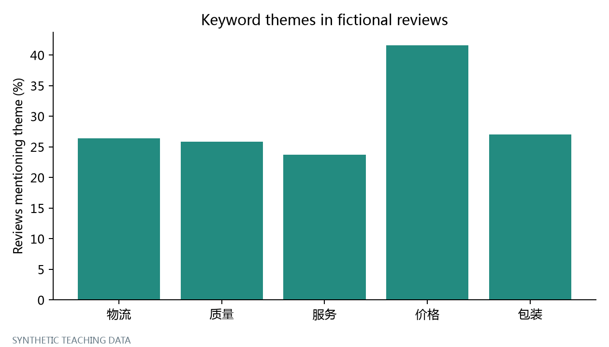

# Python电商数据分析 19 拓展：评论文本与规则式主题分析

评分之外，顾客提到了哪些具体问题？ 这个项目使用固定种子的模拟店铺数据，通过可运行的Python脚本演示分析方法。

## 学习内容

用透明的关键词规则给评论打多个主题标签，并对命中结果进行人工抽查。

核心方法：str.contains / regex / crosstab / 多标签文本。

## 运行

需要Python 3.10或以上版本。先完整克隆项目，再安装依赖并运行：

```bash
git clone https://github.com/92Jayce/python-ecommerce-19-review-text.git
cd python-ecommerce-19-review-text
python -m pip install -r requirements.txt
python main.py
```

图表、数据表和文字结果写入`results/lesson_19/`。需要Matplotlib弹窗时运行`python main.py --show`。

```bash
python smoke_check.py
```

上面的核对程序先检查主外键、订单金额、费用分摊、漏斗嵌套和库存守恒，再执行本项目。

## 项目结构

```text
main.py                 运行入口
src/analysis.py         本专题完整分析代码
course_common.py        共用读表、指标与绘图函数
data/                   已提供的模拟CSV和生成假设
results/lesson_19/      本专题示例输出
generate_data.py        固定种子重新生成模拟数据
validate_data.py        业务数据核对
requirements.txt        依赖范围
requirements-tested.txt 本次教学示例实际执行版本
```

## 数据与指标口径

数据覆盖2025年；快照上界为2026-01-01，不含该日。全部为模拟教学数据，包括1,200名客户、24个SKU、22,000次会话、3,815笔订单；没有真实个人或店铺数据。完整假设见`data/metadata.json`。

金额以整数分保存，展示时除以100。订单头与订单行不可重复累计。教学管理报表按付款/订单日组织，未按财务准则确认收入；贡献额不等于财务净利润。

主题不等于情感；虚构评论只用于代码演示，不能当成真实消费者意见。



## 课堂练习

人工抽查20条评论，记录误判；不要把字典匹配称为经过验证的情感模型。

提交修改后的代码、指标定义、结果和一段与数据对应的解释。

## 系列项目

- [01 读懂业务数据与表的粒度](https://github.com/92Jayce/python-ecommerce-01-data-audit)
- [02 清洗、去重与隔离问题记录](https://github.com/92Jayce/python-ecommerce-02-order-cleaning)
- [03 多表关联与重复统计](https://github.com/92Jayce/python-ecommerce-03-table-joins)
- [04 销售额、退款、客单价与贡献利润](https://github.com/92Jayce/python-ecommerce-04-sales-profit)
- [05 探索性统计与异常值](https://github.com/92Jayce/python-ecommerce-05-outlier-analysis)
- [06 时间序列、环比与移动平均](https://github.com/92Jayce/python-ecommerce-06-sales-trends)
- [07 商品ABC与价格带](https://github.com/92Jayce/python-ecommerce-07-product-abc)
- [08 渠道、ROAS、ROI与获客成本](https://github.com/92Jayce/python-ecommerce-08-channel-roas)
- [09 转化漏斗与分端比较](https://github.com/92Jayce/python-ecommerce-09-conversion-funnel)
- [10 RFM与可解释客户分层](https://github.com/92Jayce/python-ecommerce-10-customer-rfm)
- [11 Cohort同期群留存](https://github.com/92Jayce/python-ecommerce-11-cohort-retention)
- [12 复购与固定观察窗客户价值](https://github.com/92Jayce/python-ecommerce-12-repeat-value)
- [13 购物篮关联规则](https://github.com/92Jayce/python-ecommerce-13-basket-association)
- [14 库存周转与补货建议](https://github.com/92Jayce/python-ecommerce-14-inventory-replenishment)
- [15 需求预测与时间顺序回测](https://github.com/92Jayce/python-ecommerce-15-demand-forecast)
- [16 用户级A/B实验与不确定性](https://github.com/92Jayce/python-ecommerce-16-ab-testing)
- [17 拓展：客户聚类与解释](https://github.com/92Jayce/python-ecommerce-17-customer-clustering)
- [18 Python退款与售后分析](https://github.com/92Jayce/python-ecommerce-18-refund-analysis)
- [19 拓展：评论文本与规则式主题分析](https://github.com/92Jayce/python-ecommerce-19-review-text)
- [20 Python自动化经营看板](https://github.com/92Jayce/python-ecommerce-20-management-dashboard)
